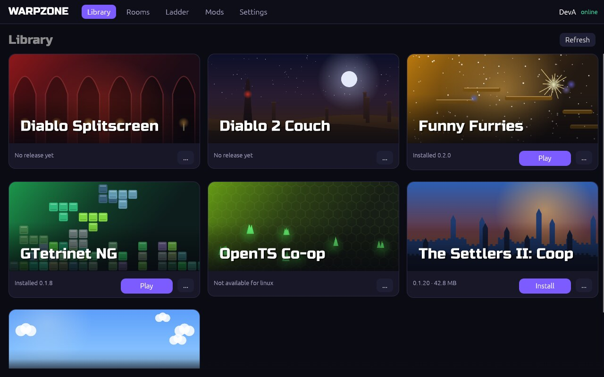

# Player guide

## The launcher

Get it from the [website](https://warpzone.virtualtabletop.io#launcher) for
Linux (and the Steam Deck) or Windows. Unpack it anywhere and start
`warpzone` / `warpzone.exe`. It is optional: every game works on its own.

* **Library** — every game, with generated artwork. One button does what is
  needed: *Install*, *Update* or *Play*. Hide games you do not care about with
  the `...` menu ("Show hidden games" or Settings brings them back).
* **Game page** — description, what's new, the game files it needs, open
  rooms, *Host a game*, *Add to Steam*, rollback to the previous version,
  uninstall.
* **Rooms** — open rooms of all games at once, with their audience; join by
  code or invite link.
* **Ladder** — standings per game and queue; *Find a match* for games that
  support ranked play.
* **Mods** — browse, add and remove; dependencies come along automatically.
* **Settings** — username, devices, recovery code, background mode, hidden
  games, Steam and invite-link integration.

On first start the launcher asks whether it may **run in the background**.
In the background it keeps your games updated and tells you when a match is
found, and it starts with your desktop. Turn it off any time in Settings →
*Running in the background*; when it is off, closing the window quits.

It works with a controller: D-pad or stick to move, A to select, B to go
back, shoulder buttons to switch tabs.

## Your identity

There is no password and no e-mail. The first Warpzone program you start
creates a key for this device; you choose a username (3–16 letters, digits,
`_` or `-`) once. Every Warpzone game and the launcher on this device use
the same identity.

* **Another device**: Settings → *Get a link code* on the first device, enter
  the code on the new one (valid 10 minutes).
* **New installation**: *Show recovery code* and write it down. Whoever has
  it can play as you — keep it private. `wz restore <code>` brings it back.

## Rooms and private games

Rooms say who they are for: languages, skill (*beginners welcome*, *mixed*,
*experienced*) and style (*casual*, *serious*, *learning*). There is no chat.

When you host you choose:

| | |
|---|---|
| **Public** | listed for everyone |
| **Private** | not listed — share the 6-letter code or the invite link |
| **Anyone joins** | no questions |
| **Code required** | the code is needed even for a listed room |
| **I approve joiners** | you see who knocks and accept or decline |

Invite links look like `warpzone://join/…#…` (they open in the launcher) or
`https://warpzone.virtualtabletop.io/join/…`.

## Connections

Players connect directly where possible (IPv6 first, then through your
router with UDP hole punching). If that fails — some mobile and shared
connections block it — the traffic goes through the Warpzone relay. Either
way it is encrypted end to end. Games show *relayed* in their connection info;
relayed play works but adds a little latency.

## Game files you already own

Several games are engines for classics and need your own copy of the
original (a GOG installer, a CD, a ROM dump). The launcher looks for them in
Steam libraries, GOG/Heroic/Lutris/Wine installs, your Downloads folder, the
Desktop and mounted discs, checks that a file is a version the game can use,
and shows buy or free-download links if nothing is found. You can add a folder
to search. Warpzone never uploads or shares these files.

## Steam and the Steam Deck

*Add to Steam* (game page, or Settings for the launcher itself) creates a
non-Steam shortcut with the game's name and full artwork (library capsule,
hero, logo, icon), so it starts from Game Mode. The shortcut starts the game
through the launcher, which updates it first. Steam must be closed while the
shortcut is written; the launcher closes it for you.

## Privacy

Stored about you: your username, your devices' public keys, ratings, match
results, leaderboard entries and mods you published. Not stored: your IP
address (it is used only while you are connected and never logged), e-mail,
contacts, play time or anything about your computer. Settings → *Delete
account* (or `wz delete-account`) removes the account, ratings and scores.
